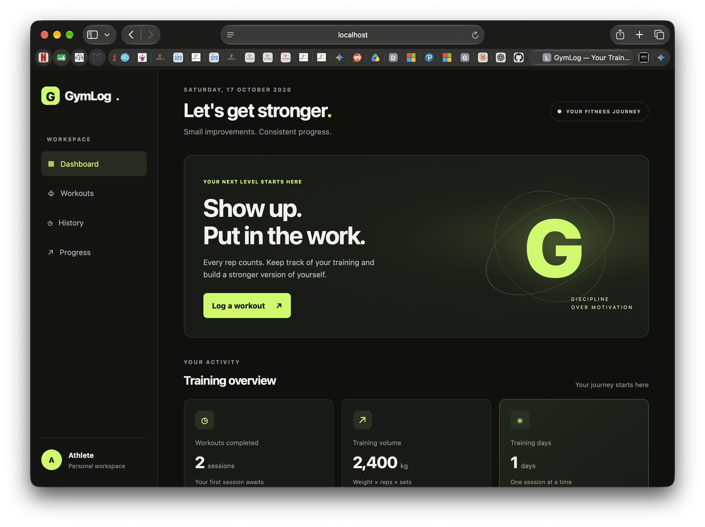

# GymLog — Workout Tracking Web Application

> **DevOps and Kubernetes — ISE-2 Assignment**  
> Individual Project · Academic Year 2026

---

## Table of Contents

1. [Project Overview](#1-project-overview)
2. [Problem Statement and Objectives](#2-problem-statement-and-objectives)
3. [Features](#3-features)
4. [Technology Stack](#4-technology-stack)
5. [Project Structure](#5-project-structure)
6. [Prerequisites and Setup](#6-prerequisites-and-setup)
7. [Running Locally](#7-running-locally)
8. [How to Use the Application](#8-how-to-use-the-application)
9. [Git Workflow](#9-git-workflow)
10. [CI/CD Integration](#10-cicd-integration)
11. [Development History](#11-development-history)
12. [Testing and Validation](#12-testing-and-validation)
13. [Screenshots / Evidence](#13-screenshots--evidence)
14. [Conclusion and Future Enhancements](#14-conclusion-and-future-enhancements)

---

## 1. Project Overview

**GymLog** is a lightweight, client-side workout tracking web application built with vanilla HTML, CSS, and JavaScript. It runs entirely in the browser — no backend server, no database, and no dependencies beyond a modern web browser. All workout data is persisted in the browser's `localStorage` under the key `gymlog-workouts-v1`.

The project demonstrates key DevOps practices learned in the ISE-2 module: version control with Git, a remote repository hosted on GitHub, and a continuous integration pipeline built with GitHub Actions that automatically validates the project on every push to `main`.

**GitHub Repository:** [https://github.com/roggerrabhii24/GymLog](https://github.com/roggerrabhii24/GymLog)

---

## 2. Problem Statement and Objectives

### Problem Statement

Athletes and fitness enthusiasts often lack a simple, privacy-respecting tool to log their daily workouts, track volume over time, and celebrate personal bests — without creating an account or relying on a third-party service that may sell their data.

### Objectives

| # | Objective |
|---|-----------|
| 1 | Build a fully functional workout logger that runs offline, in any modern browser, with zero dependencies. |
| 2 | Persist workout data locally and reliably across browser sessions using `localStorage`. |
| 3 | Provide a visual dashboard that gives the user an at-a-glance summary of their training history. |
| 4 | Track progress analytics (training volume trends) and celebrate personal bests per exercise. |
| 5 | Allow users to export their complete workout history as a standards-compliant CSV file for use in spreadsheets. |
| 6 | Demonstrate a professional DevOps workflow: Git version control, GitHub hosting, and an automated GitHub Actions CI pipeline. |

---

## 3. Features

### 3.1 Dashboard

The landing view presents three at-a-glance statistics cards:

- **Workouts completed** — total number of saved workout sessions.
- **Training volume** — cumulative weight moved across all sessions (weight × reps × sets).
- **Training days** — number of distinct calendar days on which at least one workout was saved.

Statistics update automatically whenever a workout is saved or the page is loaded.

### 3.2 Workout Logger

A structured form lets the user build a session exercise by exercise before committing it:

- Input fields: **Exercise name**, **Sets** (1–20), **Reps per set** (1–100), **Weight in kg** (0–1000, in 0.5 kg increments).
- **+ Add exercise** queues the exercise into a live *Current session* preview panel.
- Individual exercises can be removed from the session before saving.
- **Save workout ↗** commits the full session (with an ISO 8601 timestamp and a unique ID) to `localStorage` and refreshes all views.
- All inputs are validated client-side before being accepted.

### 3.3 Workout History

A reverse-chronological list of all saved workout sessions. Each card displays:

- The formatted workout date.
- A summary of exercises (name, sets × reps per exercise).
- The total training volume for that session in kg.

### 3.4 Progress Analytics

A visual analytics section that includes:

- A **bar chart** of training volume across the seven most recent training days.
- An **all-time totals** panel showing total volume, total exercises recorded, and average volume per workout.

The chart is rendered entirely in HTML/CSS — no charting library is needed.

### 3.5 Personal Best Tracking

GymLog automatically scans all saved workouts and surfaces the highest weight ever logged for each unique exercise. Ties are broken by the number of reps. Each personal best card shows the exercise name, best weight, sets × reps at that weight, and the date it was achieved.

### 3.6 Export Workout History to CSV

A clearly visible **Export CSV** button in the Workout History section:

- Reads all saved workouts from `localStorage`.
- Produces one CSV row per exercise per workout session.
- Columns: `Workout Date`, `Workout ID`, `Exercise Name`, `Sets`, `Reps per Set`, `Weight (kg)`, `Volume (kg)`.
- Follows RFC 4180 — commas, double-quotes, and line breaks inside values are escaped correctly.
- Generates a dated filename: `gymlog-workouts-YYYY-MM-DD.csv`.
- Shows a green success message after export, or a descriptive error message if the history is empty.
- Never deletes or modifies stored data.

---

## 4. Technology Stack

| Technology | Role |
|---|---|
| **HTML5** | Semantic page structure (`<article>`, `<section>`, `<nav>`, `<aside>`, `<header>`, `<footer>`) |
| **CSS3 (Vanilla)** | All styling — dark theme, CSS custom properties, Grid, Flexbox, responsive breakpoints, micro-animations |
| **JavaScript (ES2020, strict mode)** | All application logic — DOM manipulation, localStorage I/O, CSV generation, event handling |
| **localStorage API** | Client-side persistence of workout data (`gymlog-workouts-v1`) |
| **Git** | Version control — branching, committing, and pushing changes |
| **GitHub** | Remote repository hosting at `github.com/roggerrabhii24/GymLog` |
| **GitHub Actions** | CI/CD pipeline — validates every push to `main` |
| **Node.js (v20)** | Used by the CI runner to execute `node --check` for JavaScript syntax validation |
| **Python 3** | Used locally to serve the app via a simple HTTP server |

No npm packages, build tools, frameworks, or CDN-hosted libraries are used. The entire application ships as three static files.

---

## 5. Project Structure

```
GymLog/
├── .github/
│   └── workflows/
│       └── ci.yml          # GitHub Actions CI pipeline
├── index.html              # Application markup and page structure
├── styles.css              # All styles — dark theme, layout, components
├── script.js               # All application logic
└── README.md               # This document
```

### Key file responsibilities

**`index.html`**  
Defines the sidebar navigation, dashboard stat cards, workout logger form, history list, progress analytics grid, personal bests grid, and the export button. References `styles.css` via `<link>` and `script.js` via a `defer`-loaded `<script>`.

**`styles.css`**  
Contains the complete design system using CSS custom properties (`--bg`, `--panel`, `--border`, `--text`, `--muted`, `--green`, `--green-dark`). Implements the sidebar layout, all component styles, chart bar animation, export button styles, and three responsive breakpoints (`1100px`, `760px`, `500px`).

**`script.js`**  
Runs in strict mode. Manages in-memory session state (`currentSession` array), reads/writes to `localStorage`, renders all dynamic UI (history cards, volume chart bars, personal best cards), and handles the CSV export pipeline (`csvEscape` → `buildCSV` → `exportWorkoutsCSV`).

**`.github/workflows/ci.yml`**  
Defines the `GymLog CI` workflow (see [Section 10](#10-cicd-integration)).

---

## 6. Prerequisites and Setup

### macOS Prerequisites

| Requirement | Check command | Notes |
|---|---|---|
| **Git** | `git --version` | Pre-installed on macOS with Xcode Command Line Tools |
| **Python 3** | `python3 --version` | Pre-installed on macOS 12+; used to serve the app locally |
| **Node.js v20+** | `node --version` | Required only to run `node --check` manually; install via [nodejs.org](https://nodejs.org) or `brew install node` |
| **A modern browser** | — | Chrome, Firefox, Safari, or Edge |

### Clone the repository

```bash
# Clone from GitHub
git clone https://github.com/roggerrabhii24/GymLog.git

# Enter the project directory
cd GymLog
```

No `npm install`, no build step, no environment variables. The application is ready to run immediately after cloning.

---

## 7. Running Locally

Open a terminal in the project directory and start Python's built-in HTTP server:

```bash
python3 -m http.server 8000
```

Then open your browser and navigate to:

```
http://localhost:8000
```

You should see the GymLog dashboard. To stop the server, press `Ctrl + C` in the terminal.

> **Why use a server instead of opening the file directly?**  
> Opening `index.html` via `file://` works in most browsers for this project since there are no `fetch()` calls or module imports. However, serving over HTTP is the standard practice and avoids any browser security restrictions on local files.

---

## 8. How to Use the Application

### Logging a workout

1. Click **Workouts** in the sidebar (or scroll to the *Log a workout* section).
2. Enter an **Exercise name** (e.g., `Bench Press`).
3. Set **Sets**, **Reps per set**, and **Weight (kg)**.
4. Click **+ Add exercise**. The exercise appears in the *Current session* preview on the right.
5. Repeat for each exercise in the session.
6. Click **Save workout ↗**. The session is saved to `localStorage` and all statistics update immediately.

### Reviewing workout history

- Scroll to the **Workout history** section.
- Each card shows the date, exercises performed, and total volume for that session.
- Cards are ordered newest-first.

### Reading progress analytics

- Scroll to the **Progress analytics** section.
- The bar chart shows your training volume for the last seven training days.
- The totals panel on the right shows all-time volume, total exercises logged, and average volume per workout.

### Checking personal bests

- Scroll to the **Personal bests** section.
- Each card shows the highest weight you have ever logged for a given exercise, with the sets × reps achieved and the date.

### Exporting to CSV

1. Scroll to the **Workout history** section.
2. Click the **↓ Export CSV** button.
3. If you have saved workouts, the browser downloads `gymlog-workouts-YYYY-MM-DD.csv` immediately.
4. A green confirmation message confirms how many workouts and exercises were exported.
5. Open the CSV in Excel, Google Sheets, or Numbers to analyse or share your training data.

> If no workouts have been saved yet, an error message is shown and no file is downloaded.

---

## 9. Git Workflow

All changes to GymLog were version-controlled using Git and pushed to GitHub. Below are the representative commands used throughout development.

### Initial setup

```bash
git init
git remote add origin https://github.com/roggerrabhii24/GymLog.git
```

### Checking current status

```bash
git status
```

### Staging and committing changes

```bash
# Stage all changed files
git add .

# Or stage a specific file
git add script.js

# Commit with a descriptive message
git commit -m "Add CSV export for workout history"
```

### Pushing to GitHub

```bash
git push origin main
```

### Viewing history

```bash
# Compact one-line log
git log --oneline

# Detailed log with dates
git log --format="%h  %ad  %s" --date=short
```

### Example of a complete feature workflow

```bash
# After writing the CSV export feature:
git status
# On branch main
# Modified: index.html
# Modified: styles.css
# Modified: script.js

git add index.html styles.css script.js
git commit -m "Add CSV export for workout history"
git push origin main
# GitHub Actions CI pipeline triggers automatically
```

---

## 10. CI/CD Integration

Every push to the `main` branch and every pull request targeting `main` automatically triggers the **GymLog CI** pipeline defined in [`.github/workflows/ci.yml`](.github/workflows/ci.yml).

### Workflow configuration

```yaml
name: GymLog CI

on:
  push:
    branches:
      - main
  pull_request:
    branches:
      - main

jobs:
  validate:
    name: Validate GymLog
    runs-on: ubuntu-latest

    steps:
      - name: Checkout repository
        uses: actions/checkout@v4

      - name: Set up Node.js
        uses: actions/setup-node@v4
        with:
          node-version: 20

      - name: Check required project files
        run: |
          test -f index.html
          test -f styles.css
          test -f script.js
          echo "All required project files are present."

      - name: Check HTML file references
        run: |
          grep -Fq 'href="styles.css"' index.html
          grep -Fq 'src="script.js"' index.html
          echo "HTML stylesheet and JavaScript references are present."

      - name: Check JavaScript syntax
        run: node --check script.js

      - name: Report success
        run: echo "GymLog CI checks passed."
```

### What each step does

| Step | Command | Purpose |
|---|---|---|
| **Checkout repository** | `actions/checkout@v4` | Clones the repository onto the GitHub-hosted Ubuntu runner |
| **Set up Node.js** | `actions/setup-node@v4` (v20) | Installs Node.js so that `node --check` is available |
| **Check required project files** | `test -f index.html` × 3 | Fails the build if any of the three core files (`index.html`, `styles.css`, `script.js`) is missing |
| **Check HTML file references** | `grep -Fq 'href="styles.css"'` etc. | Verifies that `index.html` actually links to `styles.css` and `script.js`; catches broken references |
| **Check JavaScript syntax** | `node --check script.js` | Parses `script.js` for syntax errors without executing it; exits non-zero on any parse error |
| **Report success** | `echo "GymLog CI checks passed."` | Prints a confirmation message so the Actions log is easy to read at a glance |

### Running the CI checks locally

You can replicate every CI check on your own machine:

```bash
# Step 1 — required files
test -f index.html && test -f styles.css && test -f script.js && echo "Files OK"

# Step 2 — HTML references
grep -Fq 'href="styles.css"' index.html && echo "CSS ref OK"
grep -Fq 'src="script.js"'  index.html && echo "JS ref OK"

# Step 3 — JavaScript syntax
node --check script.js && echo "Syntax OK"
```

---

## 11. Development History

The table below lists every commit in the repository, derived from `git log --oneline`. All hashes and messages are real.

| # | Short Hash | Date | Commit Message | What changed |
|---|---|---|---|---|
| 7 | `8e7fff5` | 2026-10-17 | Fix CI workflow trailing blank line | Removed a trailing blank line in `ci.yml` to keep the YAML file clean |
| 6 | `5d33765` | 2026-10-17 | Clean up CI workflow formatting | General formatting improvements to `ci.yml` |
| 5 | `3e6a096` | 2026-10-17 | Add CSV export for workout history | Added `Export CSV` button, RFC 4180-compliant `buildCSV`/`csvEscape` functions, download logic, and success/error message in `index.html`, `styles.css`, and `script.js` |
| 4 | `f0be780` | 2026-10-17 | Add GitHub Actions CI workflow | Created `.github/workflows/ci.yml` with four validation steps |
| 3 | `b5ba12d` | 2026-10-17 | Add workout progress analytics and personal bests | Added volume bar chart, analytics totals panel, and personal best cards; added `renderAnalytics`, `renderVolumeChart`, `renderPersonalBests` functions |
| 2 | `c1ab0fc` | 2026-10-17 | Add workout logging and session history | Added exercise form, session preview panel, save logic, history list rendering, and localStorage read/write |
| 1 | `f5a0e6a` | 2026-10-17 | Initial commit: create GymLog dashboard | Created `index.html`, `styles.css`, `script.js` with sidebar, hero section, and stat cards |

---

## 12. Testing and Validation

GymLog is validated at three levels: automated CI checks on every push, manual browser testing, and local Node.js syntax checking.

### 12.1 Automated CI validation (GitHub Actions)

On every push to `main`, the pipeline:

1. Confirms all three source files exist.
2. Confirms `index.html` references both `styles.css` and `script.js`.
3. Confirms `script.js` has no JavaScript syntax errors (`node --check`).

A green checkmark on GitHub Actions indicates all checks passed.

### 12.2 JavaScript syntax — local check

```bash
node --check script.js && echo "✓ Syntax OK"
# Output: ✓ Syntax OK  (exit code 0)
```

### 12.3 Manual functional testing

| Test scenario | Expected result | Result |
|---|---|---|
| Open `http://localhost:8000` | Dashboard loads with zero-state stats cards | ✓ Pass |
| Add an exercise and click **Save workout ↗** | Session saved; history card appears; stats update | ✓ Pass |
| Add multiple exercises to one session | All exercises appear in preview; all saved together | ✓ Pass |
| Click **Remove** on a session exercise | Exercise removed from preview; save button disabled if empty | ✓ Pass |
| Reload the page | Previously saved workouts persist (loaded from localStorage) | ✓ Pass |
| Check analytics after saving 2+ workouts | Volume chart bars and totals panel update correctly | ✓ Pass |
| Check personal bests | Highest weight per exercise shown with correct date | ✓ Pass |
| Export CSV with saved workouts | File downloaded; one row per exercise; columns correct | ✓ Pass |
| Export CSV with no workouts saved | Error message shown; no file downloaded | ✓ Pass |
| Open on mobile (< 500 px wide) | Sidebar collapses to horizontal nav; layout is usable | ✓ Pass |

### 12.4 CSV output sample

A sample exported CSV (two workouts, three exercises total):

```
Workout Date,Workout ID,Exercise Name,Sets,Reps per Set,Weight (kg),Volume (kg)
2026-10-17,1729167908-abc123,Bench Press,3,10,80,2400
2026-10-17,1729167908-abc123,Squat,4,8,100,3200
2026-10-17,1729168500-def456,Deadlift,3,5,120,1800
```

Values containing commas or double-quotes are wrapped in double-quotes and internal quotes are doubled (RFC 4180 compliant). Line endings are CRLF as required by the standard.

---

## 13. Screenshots / Evidence

---

### 13.1 GymLog Dashboard



---

### 13.2 Workout Logger — Adding Exercises


---

### 13.3 Workout History Section


---

### 13.4 Progress Analytics and Volume Chart


---

### 13.5 Personal Bests


---

### 13.6 CSV Export — Success Message


---

### 13.7 Exported CSV File Opened in Spreadsheet


---

### 13.8 GitHub Repository


---

### 13.9 GitHub Commit History


---

### 13.10 GitHub Actions — Successful CI Run


---

### 13.11 node --check Output (Local Terminal)

.png)

---

## 14. Conclusion and Future Enhancements

### Conclusion

GymLog successfully achieves all six objectives set out in Section 2. It provides a clean, privacy-first workout tracking experience that requires no account, no internet connection, and no installation. The project demonstrates a complete DevOps workflow:

- **Source control** — all changes tracked with meaningful commit messages in Git.
- **Remote hosting** — repository published on GitHub with a public commit history.
- **Continuous integration** — every push to `main` automatically triggers a GitHub Actions pipeline that verifies file presence, HTML integrity, and JavaScript syntax correctness.

The project is intentionally minimal in its technology choices — three static files, no dependencies — which makes it robust, fast, and easy to maintain.

### Possible Future Enhancements

| Enhancement | Description |
|---|---|
| **Workout templates** | Save named workout templates (e.g., "Push Day") and pre-fill the logger form from them. |
| **Rest-timer** | An in-browser countdown timer between sets, with a browser notification when the rest period ends. |
| **Bodyweight exercises** | Support bodyweight exercises where weight = 0 kg but volume is still tracked by reps. |
| **CSV import** | Allow users to import a previously exported CSV back into the app, enabling data migration between devices. |
| **IndexedDB storage** | Replace `localStorage` with IndexedDB for larger storage limits and structured queries. |
| **Progressive Web App (PWA)** | Add a `manifest.json` and Service Worker so GymLog can be installed on a phone home screen and used fully offline. |
| **Unit tests** | Add `node:test` (built into Node.js 18+) test cases for `csvEscape`, `buildCSV`, `calculateVolume`, and `loadWorkouts` to strengthen CI. |
| **Containerisation** | Package the app in a Docker container with an `nginx` web server and deploy to Kubernetes — a natural next step for the DevOps and Kubernetes module. |

---

*Built with discipline. Tracked with GymLog.*
